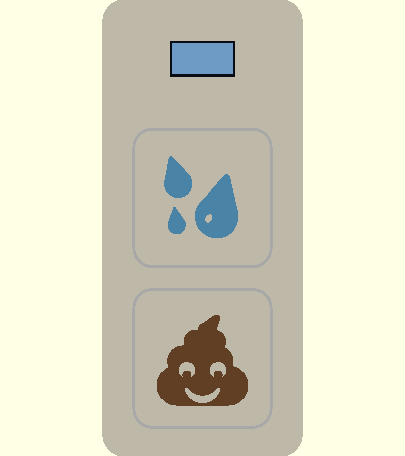
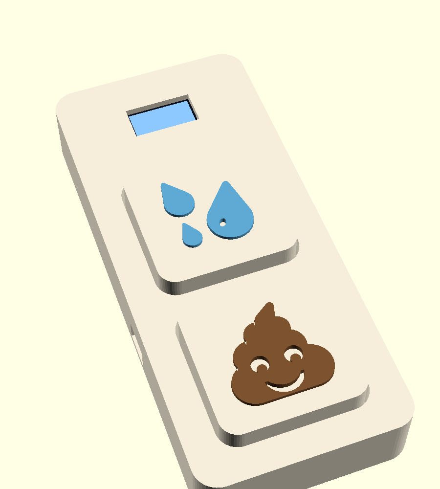
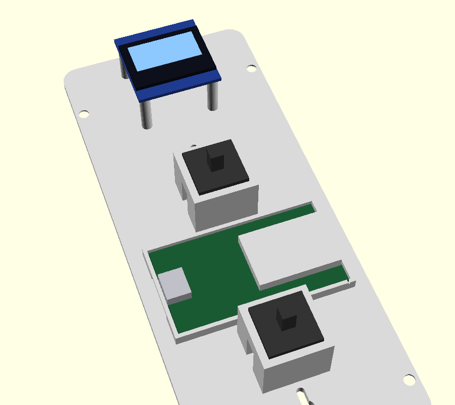

# Biru Buttons · switch plate (design 03)

Two big square caps on a wall plate beside the door — 💦 for pee, 💩 for
poop — with a 0.96" OLED above them showing today's tally. Every part prints flat-side-down with **zero supports**, and the emoji
are real 3D geometry (no fonts): they print as separate colour inlays that
stand 1 mm proud of the cap face.

 

Plate 70 × 160 × 22 mm, caps 47 mm square standing 6 mm proud, one MX-style
switch under each cap, OLED window at the top. `../../designs/two-button/03-switch-plate.png` is the
concept sheet this follows.

## Parts

Each STL's name starts with the filament colour to print it in.

| STL | qty | print | notes |
|---|---|---|---|
| `cream-face.stl` | 1 | face down | front shell: cap wells with 12 mm guide tubes, OLED window + pocket, 4 × M3 heat-set bosses, USB notch |
| `cream-back.stl` | 1 | flat | (hidden on the wall — any colour) back plate: two 15 mm switch towers, ESP32 rail, 4 OLED clamp posts, 2 keyholes, 4 countersunk M3 |
| `cream-cap-sweat.stl`, `cream-cap-poop.stl` | 1 each | face down | cap with a 1 mm recess in the shape of the emoji |
| `blue-inlay-sweat-0/1/2.stl` | 1 each | face down | the three 💦 drops (blue) |
| `brown-inlay-poop.stl` | 1 | face down | 💩 (brown); eyes and smile are through-holes so the cap colour shows |
| `multicolor-cap-*-onepiece.stl` | — | needs MMU / supports | cap + raised emoji in one body, for multi-material printers only |

Glue the inlays into the recess (a dab of CA). Suggested colours: caps in
cream or white, drops in blue, poop in brown — the eyes/smile then come out
cream automatically.

## Electronics

`board` in `config.scad` picks the bay:

- **`"devkit32"` (default)** — the 30-pin ESP-WROOM-32 devkit from the
  breadboard (CP2102, USB-C, ~52 × 28.5 mm — **caliper yours** and set
  `dk_l` / `dk_w`). It lies flat between the two switch towers, behind the
  cap guide tubes, so nothing collides even with the caps pressed. **Cut the
  header pins flush** (side cutters, leave ~1 mm stubs) — with full pins it's
  too tall. The USB exits through a notch in the **side** of the plate;
  `usb_side = 1` puts the cable on your left as you face it, `-1` right.
- **`"c3"`** — ESP32-C3 SuperMini (18 × 23.5 mm) in a rail beside the lower
  switch, USB-C out the **bottom**. Tidier if you ever swap boards.



Wiring (both boards) is the same as the breadboard —
[`../../BREADBOARD.md`](../../BREADBOARD.md): each switch has two pins → one
to a GPIO (pee D18, poop D19), one to GND; the firmware uses `INPUT_PULLUP`,
no resistor. The towers have wire slots on both sides. Power over USB. The
breadboard's tactile buttons are swapped for MX switches in the case.

## OLED

0.96" SSD1306 128×64 I²C module (the generic 4-pin blue board), upright with
its header along the **top** edge: GND → GND, VCC → 3V3, SCL → D22,
SDA → D21. The glass nests in a ledge behind the front skin, and four posts
on the back plate clamp the PCB against it when the case closes — no screws
or glue. Each post has a short pin that drops into the module's M2 corner
hole. Straight header pins clear the back plate (~8.5 mm needed, 17 mm free).

These modules vary by a few tenths between sellers, so before printing
caliper yours and set in `config.scad`:

- `oled_pcb` — PCB width × height
- `oled_glass`, `oled_glass_top` — glass size, and the distance from the PCB's
  top edge to the glass's top edge
- `oled_aa_top` — PCB top edge to the first row of pixels (power it on to
  see). The window is the 128 × 64 active area plus `oled_win_margin`.

## How it goes together

```
wall ─ back plate (keyholes / command strips)
       └ towers: switch clips into a 14 mm cut on top, wires out the side slots
       └ ESP32-C3 SuperMini sits in the rail, USB-C out the bottom of the shell
     front shell screws onto the back plate from behind (M3 × 6 into inserts)
     caps drop onto the switch stems from the front; the skirt rides in the guide tube
```

Cap height is derived, not guessed: `tower_h` in `config.scad` is solved so
the cap face rests `cap_proud` off the front with `stem_top = 6.6` mm of MX
stem above the plate. Change any of those and the tower follows.

## Print settings

0.2 mm layers, 3 walls, 20 % infill, PETG or PLA. Face and caps get the bed
finish on the visible side — a textured PEI sheet looks great here. Inlays
are small; print all four together with a brim.

## Test-fit first (the three tolerances that matter)

1. **Stem cross** — `cross_t = 1.35` (1.27 nominal + slack). Print one cap,
   press it on a switch: too loose → 1.30, cracks the boss → 1.40.
2. **Cap in well** — `well_clear = 1.0` per side. Sticky → 1.2. Rattly → 0.8.
3. **Inlay in recess** — `inlay_clear = 0.12`. Won't seat → 0.2.
4. **OLED in pocket** — `oled_clr = 0.4`, `glass_clr = 0.3`. Print only the
   top ~40 mm of `cream-face.stl` (cut it in the slicer) to check the module seats
   and the pixels line up with the window before the full print.

Also check the MX cut (`mx_cut = 14.0`) clips firmly on your switches.

## Files

`config.scad` (every dimension) · `emoji.scad` (the 2D 💦/💩 outlines) ·
`cap.scad` (`kind`, `part`, `piece` params) · `face.scad` · `back.scad` ·
`assembly.scad` (preview only) · `render.sh` (needs `openscad` on PATH — on
macOS `brew install --cask openscad@snapshot`, the stable cask is
Gatekeeper-blocked).
